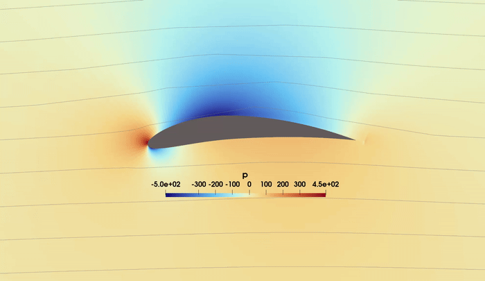

# NACA Airfoil Camber Study — OpenFOAM Automation Pipeline

Automated OpenFOAM pipeline for studying the effect of camber on lift and drag
coefficients for a NACA 4-digit airfoil family, including mesh convergence,
time convergence, and a camber parameter sweep. All meshing, case setup,
solving, and post-processing is driven from Python and run inside a Docker
container for reproducibility.



## Repository Layout

```
.
├── README.md
├── convergence_study.py          # Phase 1: mesh convergence + Phase 2: time convergence
├── parameter_study.py             # Camber (M = 0-8) parameter sweep
├── src/
│   ├── generate_constant.py       # momentumTransport, physicalProperties, 0/ field writers
│   ├── mesh_solver.py             # generate_naca4, curiosityFluidsAirfoilMesher (blockMeshDict writer)
│   └── control_dict.py            # create_control_dict, fvSchemes/fvSolution writer
├── results/
│   ├── convergence_results.json           # Mesh convergence: Cl/Cd vs. points
│   ├── time_convergence_results.json      # Time convergence: Cl/Cd/residuals vs. time
│   ├── parameter_study_results.json       # Camber sweep: Cl/Cd vs. M
│   ├── Postprocessing_plotting.ipynb      # Recreate all plots from json files
│   ├── Paraview/
│       ├── mesh_paraview.pvsm             # statefile to recreate paraview outputs
│       └── airfoil.gif                    # airfoil video used in readme
│   └── plots/
│       ├── convergence_error_plot.png
│       ├── time_convergence_study.png
│       ├── camber_vs_Cl.png
│       └── camber_vs_Cd.png
└── report/
    └── minipaper.pdf             
```

## Requirements

- Python 3.10+
- Docker Desktop, running, with the `microfluidica/openfoam:13` image
  available (pulled automatically on first run)
- Python packages: `numpy`, `pandas`, `matplotlib`

```bash
pip install numpy pandas matplotlib
```

## Reproducing the Study

All commands below are run from the repository root.

### 1. Mesh convergence study (Part 1) + time convergence study (Part 2)

Runs both phases in sequence: a surface-discretization sweep
(`points = 20, 40, 60, 80, 160, 320, ...`, edit `point_options` in
`convergence_study.py` to change), followed by a single longer run at the
finest successful resolution to determine the required simulation duration.

```bash
python convergence_study.py --steady
```

Key flags:
- `--airfoil 8412` — NACA 4-digit code used for the convergence study (default: `8412`)
- `--u_freestream 30.0`, `--rho_freestream 1.225`, `--nu 1.5e-5` — flow conditions
- `--endtime 0.6` — end time (transient seconds, or steady-state iteration count) used for Part 1's mesh sweep
- `--time_study_points 320` — override which resolution Part 2 uses (defaults to the finest resolution that succeeded in Part 1)
- `--time_study_endtime 0.6` — end time for the Part 2 run (kept generous so the full settling behavior is visible)
- `--steady` — use steady-state (SIMPLE) instead of transient (Euler/PIMPLE); **steady-state was used for all final results in this study** (see Methods section for justification)

Outputs: `convergence_results.json`, `convergence_error_plot.png`,
`time_convergence_results.json`, `time_convergence_study.png`.

### 2. Mesh convergence only (skip time convergence)

Not currently a built-in flag in every version of the script — if your copy
of `convergence_study.py` doesn't support skipping Part 2, run Part 1 with a
very short `--time_study_endtime` so Part 2 completes almost instantly and
can simply be ignored:

```bash
python convergence_study.py --steady --time_study_endtime 0.01
```

Or, if you've added the `--skip_mesh_study` flag (see conversation history /
script comments), the inverse — time convergence only, skipping the mesh
sweep entirely — is run as:

```bash
python convergence_study.py --steady --skip_mesh_study --time_study_points 320 --time_study_endtime 0.6
```

### 3. Camber parameter study

Runs the validated mesh resolution and simulation duration across a sweep of
camber values (NACA `M` digit, 0–8% of chord), holding max-camber position
(`P=4`) and thickness (`T=12`) fixed, producing the final `NACA X412` family
used in the report.

```bash
python parameter_study.py --points 320 --endtime 0.4 --steady
```

Key flags:
- `--points 320` — surface discretization points (from the mesh convergence result)
- `--endtime 0.4` — simulation duration / iteration count (from the time convergence result)
- `--camber_min 0 --camber_max 8 --camber_step 1` — camber sweep range (default: full 0–8 range)
- `--camber_position 4`, `--thickness 12` — fixed NACA digits (P, T)
- `--steady` — steady-state solver, matching the convergence studies

The script supports resuming an interrupted sweep: if
`parameter_study_results.json` already contains results for some camber
values, those are skipped automatically on a rerun rather than recomputed.

Outputs: `parameter_study_results.json`, `camber_vs_Cl.png`, `camber_vs_Cd.png`
